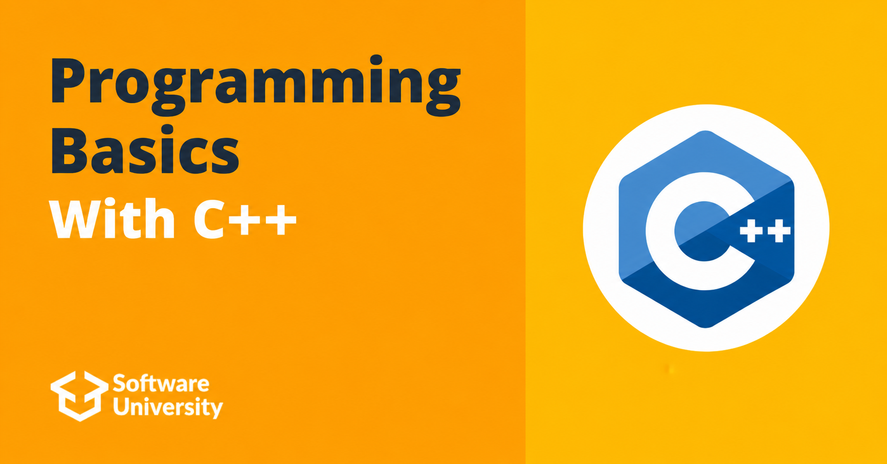

# Programming Basics with C ++

## Intro
The "Programming Basics" course provides basic programming skills required for all technology majors at the Software University. You will learn to write entry-level programming code (basic coding skills). You will work with an IDE and learn to read input data and print results to the console. You will learn to use variables and data, work with operators and expressions. Attention will be paid to the use and application of conditional constructs (if, if-else) and loops (for, while, do-while). The development environment that will be used by the training team is Visual Studio, but each student is free to use tools of their preference.

To learn more about the course you can check [Softuni](https://softuni.bg/)

## Course topics

### First Steps In Coding
- [Lab](https://github.com/Dimitar-Peev/Programming-Basics-with-C-Plus-Plus/tree/main/01.%20First%20Steps%20In%20Coding/01.%20Lab)
- [Exercise](https://github.com/Dimitar-Peev/Programming-Basics-with-C-Plus-Plus/tree/main/01.%20First%20Steps%20In%20Coding/02.%20Exercise)
- [More Exercises](https://github.com/Dimitar-Peev/Programming-Basics-with-C-Plus-Plus/tree/main/01.%20First%20Steps%20In%20Coding/03.%20More%20Exercises)
### Conditional Statements
- [Lab](https://github.com/Dimitar-Peev/Programming-Basics-with-C-Plus-Plus/tree/main/02.%20Conditional%20Statements/01.%20Lab)
- [Exercise](https://github.com/Dimitar-Peev/Programming-Basics-with-C-Plus-Plus/tree/main/02.%20Conditional%20Statements/02.%20Exercise)
- [More Exercises](https://github.com/Dimitar-Peev/Programming-Basics-with-C-Plus-Plus/tree/main/02.%20Conditional%20Statements/03.%20More%20Exercises)
### Conditional Statements Advanced
- [Lab](https://github.com/Dimitar-Peev/Programming-Basics-with-C-Plus-Plus/tree/main/03.%20Conditional%20Statements%20Advanced/01.%20Lab)
- [Exercise](https://github.com/Dimitar-Peev/Programming-Basics-with-C-Plus-Plus/tree/main/03.%20Conditional%20Statements%20Advanced/02.%20Exercise)
- [More Exercises](https://github.com/Dimitar-Peev/Programming-Basics-with-C-Plus-Plus/tree/main/03.%20Conditional%20Statements%20Advanced/03.%20More%20Exercises)
### For Loop
- [Lab](https://github.com/Dimitar-Peev/Programming-Basics-with-C-Plus-Plus/tree/main/04.%20For%20Loop/01.%20Lab)
- [Exercise](https://github.com/Dimitar-Peev/Programming-Basics-with-C-Plus-Plus/tree/main/04.%20For%20Loop/02.%20Exercise)
- [More Exercises](https://github.com/Dimitar-Peev/Programming-Basics-with-C-Plus-Plus/tree/main/04.%20For%20Loop/03.%20More%20Exercises)
### While Loop 
- [Lab](https://github.com/Dimitar-Peev/Programming-Basics-with-C-Plus-Plus/tree/main/05.%20While%20Loop/01.%20Lab)
- [Exercise](https://github.com/Dimitar-Peev/Programming-Basics-with-C-Plus-Plus/tree/main/05.%20While%20Loop/02.%20Exercise)
- [More Exercises](https://github.com/Dimitar-Peev/Programming-Basics-with-C-Plus-Plus/tree/main/05.%20While%20Loop/03.%20More%20Exercises)
### Nested Loops
- [Lab](https://github.com/Dimitar-Peev/Programming-Basics-with-C-Plus-Plus/tree/main/06.%20Nested%20Loops/01.%20Lab)
- [Exercise](https://github.com/Dimitar-Peev/Programming-Basics-with-C-Plus-Plus/tree/main/06.%20Nested%20Loops/02.%20Exercise)
- [More Exercises](https://github.com/Dimitar-Peev/Programming-Basics-with-C-Plus-Plus/tree/main/06.%20Nested%20Loops/03.%20More%20Exercises)

## Exams
- [Programming Basics Online Exam - 9 And 10 March 2019](https://github.com/Dimitar-Peev/Programming-Basics-with-C-Plus-Plus/tree/main/PB%20-%20Exams/PB_Online_Exam_9_and_10_March_2019)
- [Programming Basics Online Exam - 6 And 7 April 2019](https://github.com/Dimitar-Peev/Programming-Basics-with-C-Plus-Plus/tree/main/PB%20-%20Exams/PB_Online_Exam_6_and_7_April_2019)
- [Programming Basics Online Exam - 20 And 21 April 2019](https://github.com/Dimitar-Peev/Programming-Basics-with-C-Plus-Plus/tree/main/PB%20-%20Exams/PB_Online_Exam_20_and_21_April_2019)
- [Programming Basics Retake Online Exam - 2 And 3 May 2019](https://github.com/Dimitar-Peev/Programming-Basics-with-C-Plus-Plus/tree/main/PB%20-%20Exams/PB_Online_Retake_Exam_2_and_3_May_2019)
- [Programming Basics Online Exam - 15 And 16 June 2019](https://github.com/Dimitar-Peev/Programming-Basics-with-C-Plus-Plus/tree/main/PB%20-%20Exams/PB_Online_Exam_15_and_16_June_2019)
- [Programming Basics Online Exam - 6 And 7 July 2019](https://github.com/Dimitar-Peev/Programming-Basics-with-C-Plus-Plus/tree/main/PB%20-%20Exams/PB_Online_Exam_6_and_7_July_2019)
- [Programming Basics Online Exam - 28 And 29 March 2020](https://github.com/Dimitar-Peev/Programming-Basics-with-C-Plus-Plus/tree/main/PB%20-%20Exams/PB_Online_Exam_28_and_29_March_2020)
- [Programming Basics Online Exam - 18 And 19 July 2020](https://github.com/Dimitar-Peev/Programming-Basics-with-C-Plus-Plus/tree/main/PB%20-%20Exams/PB_Online_Exam_18_and_19_July_2020)
